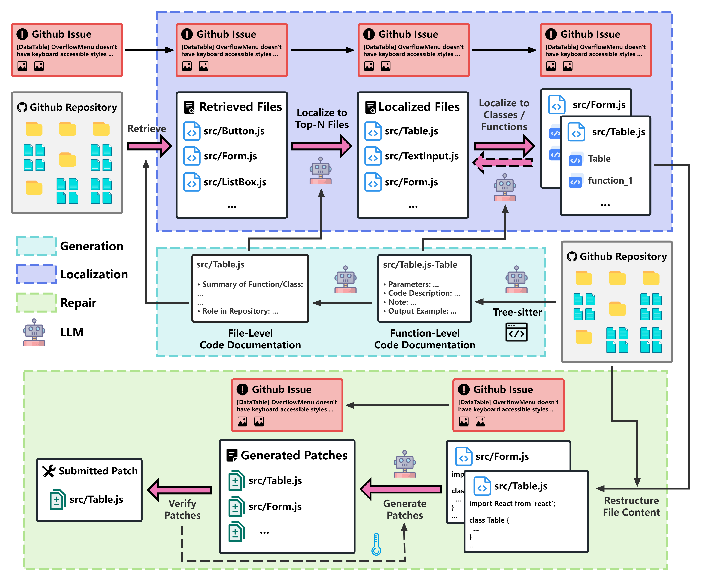

# RepoRepair

RepoRepair is a novel documentation-driven approach for repository-level automated program repair, which leverages hierarchically generated code documentation to achieve precise fault localization and cost-effective patch generation across diverse programming languages. Evaluated on both SWE-bench Lite and Multimodal benchmarks, it achieves state-of-the-art repair rate (**45.67% on Lite, 37.13% on Multimodal**) while maintaining superior cost efficiency.



## Key Features

- 📚 **Documentation-Aware**:  
  Uses LLM-generated code documentation for cross-file context understanding.
- 🌐 **Language-Agnostic Design**:  
  Supports JavaScript/TypeScript and Python repositories through AST-based parsing and generalized documentation generation.
- 💰 **Cost Efficiency**:  
  Achieves average repair costs of **\$0.44** on SWE-bench Lite and **\$0.56** on SWE-bench Multimodal.

## Performance Highlights

| Metric                            | RepoRepair | Agentless Lite | Improvement |
|-----------------------------------|------------|----------------|-------------|
| **Lite Results**                  |            |                |             |
| %Resolved                         | 45.67%     | 32.33%         | +13.34%     |
| Avg. Cost/Repair                  | \$0.44     | \$0.21         | +0.23       |
| **Multimodal Results**            |            |                |             |
| %Resolved                         | 37.13%     | 25.34%         | +11.79%     |
| Avg. Cost/Repair                  | \$0.56     | \$0.38         | +0.18       |

_\*Agentless Lite uses different model configurations across benchmarks_

## Installation

```bash
git clone https://github.com/ZhongQiangDev/RepoRepair.git
cd RepoRepair
pip install -r requirements.txt  # Requires Python 3.9+
```

## Usage

### 1. Resource Download

```bash
# Download issues and repositories
python issue_diff_download.py

python issue_repo_download.py
python unzip.py
```

* Use **Selenium** to fetch the repository's compressed file from GitHub.

### 2. Repository Parsing

```bash
# Parse code and analyze dependencies
python CodeParser.py  # Uses Tree-sitter for PY/JS/TS parsing
python DependencyGraph.py
python generate_doc_meta.py  # Output: repo_doc_meta/
```

### 3. Code Documentation Generation
```bash
# Generate documentation at different levels
python generate_document_func.py  # Output: repo_document_func/

python generate_document_file.py  # Output: repo_document_file/
```

* Cloud resources are released in Google Drive: https://drive.google.com/file/d/1jAWcQy3HM-Fu37r1CAoBO5MerSGFluRp/view?usp=sharing, https://drive.google.com/file/d/1rAiVn4o5FK-OHqPoGoc-GoDWXxJqQp5I/view?usp=sharing.

### 4. File Retrieval
```bash
# Analyze and retrieve relevant files
python ps_cause_analyze.py  # Output: problem_statement_analysis/

python file_retrival.py  # Uses LangChain, output: repo_file_rag/
```

### 5. Localization
```bash
# Hierarchical localization
python file_localization.py  # Output: buggy_files/

python func_localization.py  # Output: buggy_elements/
```


### 6. Repair
```bash
# Generate patches
python bug_repair.py  # Output: bug_repair/
```

## Directory Structure

```bash
├── repo_doc_meta/              # Parsed repository metadata
├── repo_document_func/         # Function-level documentation
├── repo_document_file/         # File-level documentation
├── problem_statement_analysis/ # Issue analysis results
├── repo_file_rag/              # Retrieved files
├── buggy_files/                # Localized problematic files  
├── buggy_elements/             # Localized functions/classes
└── bug_repair/                 # Generated patches
```
